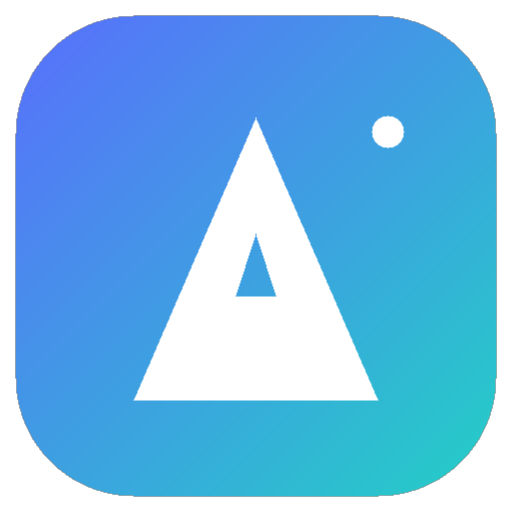
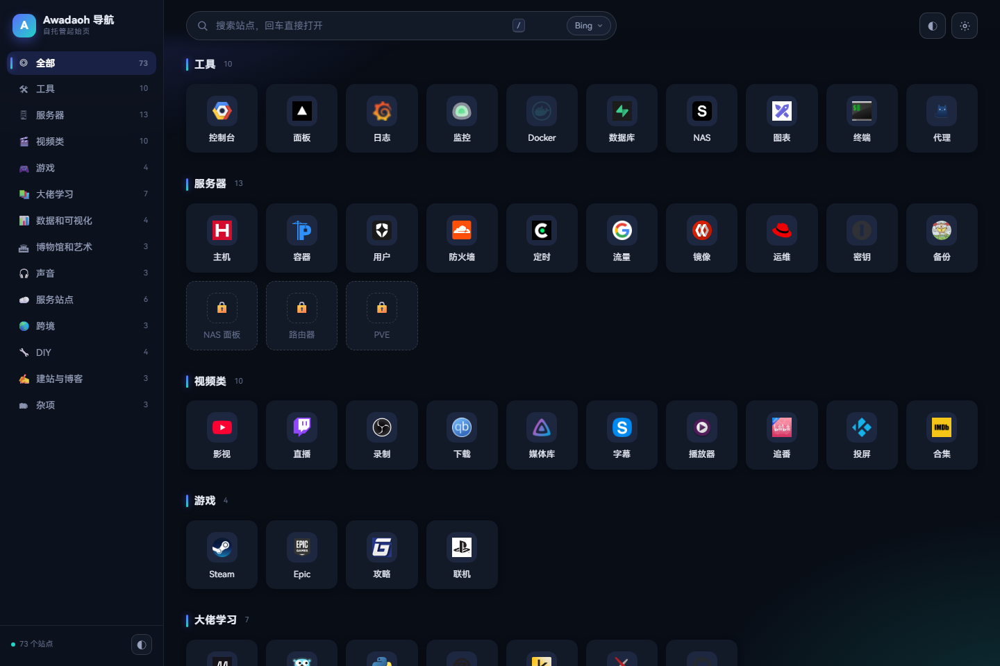
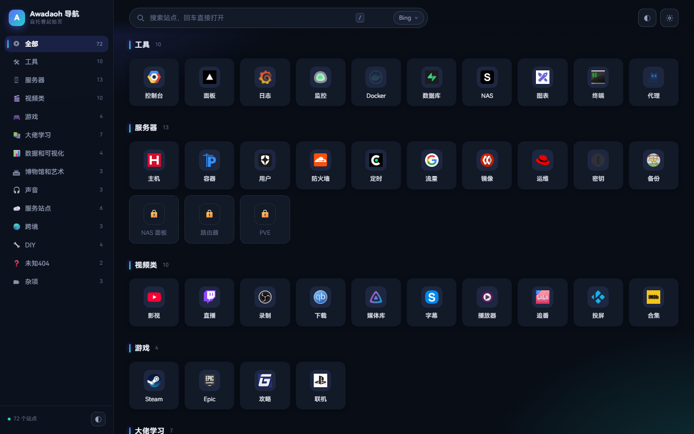
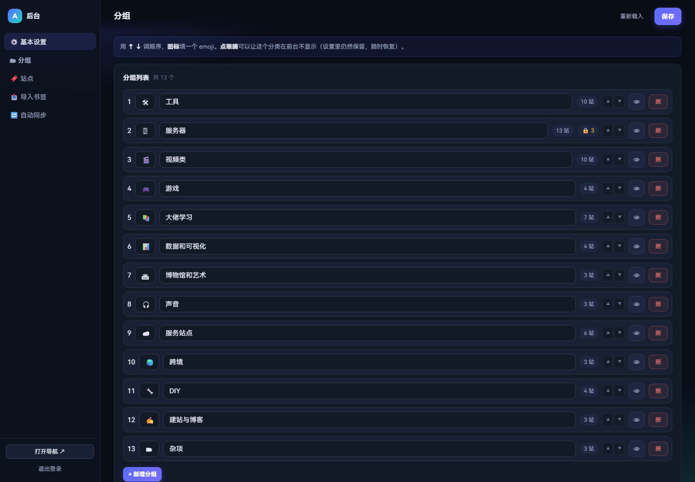
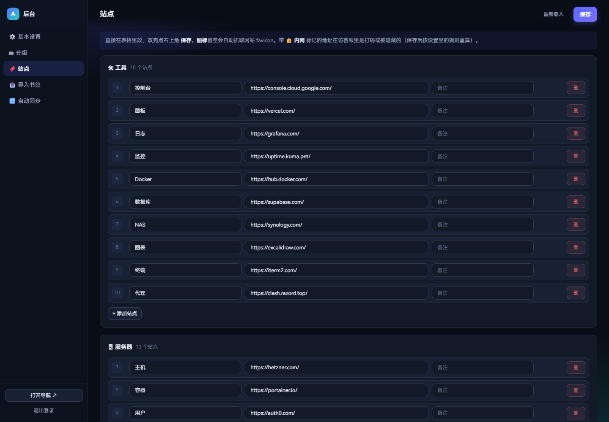
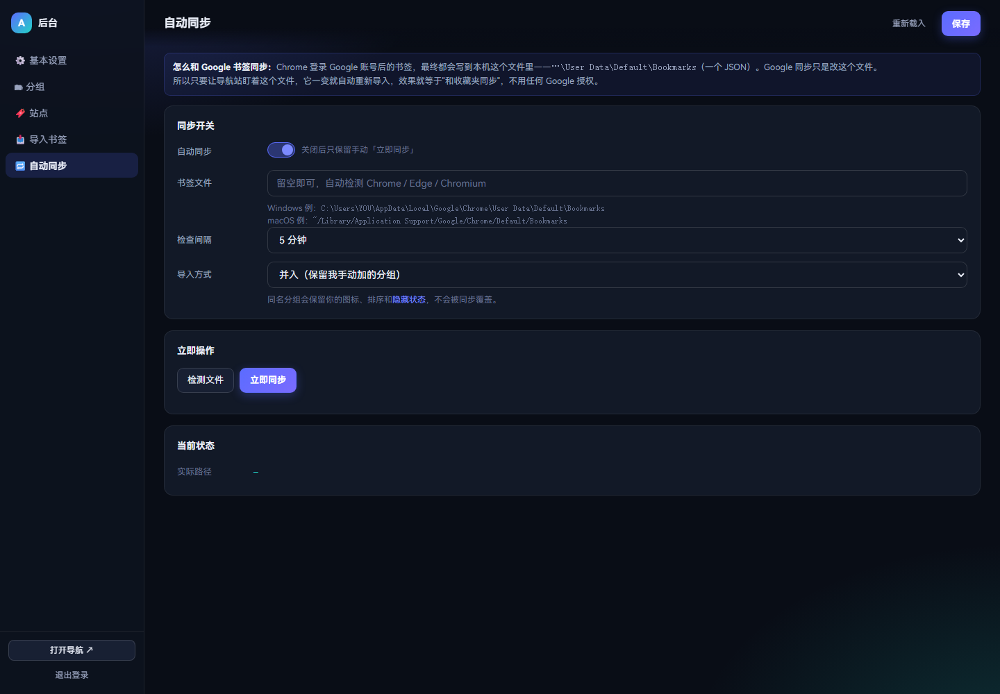
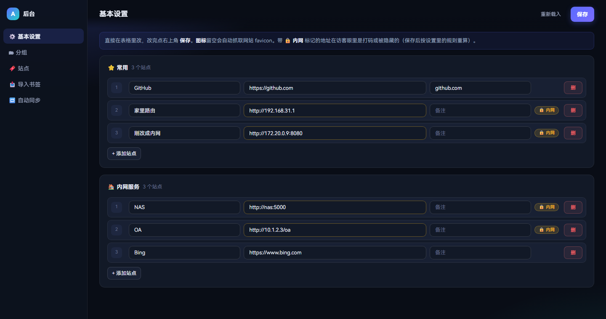

<div align="center">



# Awadaoh

**自托管导航面板 / NAS 首页 / 浏览器起始页**

一个可以自己部署、自己掌控的网址导航站：分组管理图标、内置搜索、系统监控、Docker 容器管理、多用户与访客模式。



</div>

---

## 一个仓库，两种形态

| | 完整面板（`service/` + `src/`） | 极简导航站（`nav/`） |
|---|---|---|
| 定位 | 分组图标 + 搜索 + 系统监控 + Docker 管理，带后台 | 打开就是导航页，后台只改配置 |
| 技术 | Go 1.21 + Vue 3，**镜像里前后端都从本仓库源码构建** | Python 3.8+ / 15 MB 镜像 |
| 前台 | 访客直接看到导航，没有登录墙 | 同 |
| 装法 | `docker compose up -d`（拉 ghcr 镜像） | `cd nav && docker compose up -d` |
| 适合 | 想要 NAS 控制台那一套 | 只想要一个好看的起始页 |

两种形态共用同一套产品逻辑：**分类三态可见性**（公开 / 仅登录可见 / 隐藏）、**内网地址打码**（外网访客看不到 `192.168.*`，点开提示需要内网环境）、左侧分类 + 图标网格 + 搜索框。

---

## 完整面板：三条命令

```bash
git clone https://github.com/awahello/awadaoh.git
cd awadaoh
docker compose up -d
```

打开 `http://<你的IP>:3055` —— **直接就是导航页，不是登录框**。

后台在 `/login`，默认账号：

| 账号 | 密码 |
|---|---|
| `admin` | `12345678` |

> - 老版本装过的实例用户名是 `admin@sun.cc`，新版本启动时会自动改名为 `admin`。
> - 忘了密码：`docker exec -it awadaoh /app/awadaoh -password-reset`，它会把第一个管理员的密码重置成默认值，并把用户名打出来。
> - 访客模式默认就开：没配「公开访问账号」时后端自动用第一个管理员当访客身份，所以打开域名有内容；后台换一个访客账号后立即生效。

镜像同时有 `linux/amd64` 和 `linux/arm64`，构建时自带 ELF 架构守卫，不会出现标签写 arm64、里面躺 amd64 二进制的情况：

```bash
docker pull ghcr.io/awahello/awadaoh:latest
docker image inspect ghcr.io/awahello/awadaoh:latest | grep -E '"Os"|"Architecture"'
```

想自己从源码构建（不需要上游任何物料）：

```bash
docker build -t awadaoh:local .
```

---

## 极简导航站（`nav/`）



- **打开网页直接就是导航**，没有登录墙
- **分类 + 图标网格**，左侧分类点一下就筛；搜索框回车：站内有匹配直接跳，没有就走搜索引擎
- **搜索引擎可切可换**：内置 Bing / Google / 百度 / DuckDuckGo / GitHub / 哔哩哔哩，后台能增删改、设默认
- **直接导入 Chrome 书签**：导出的 `bookmarks.html` 拖进去，或者直接选浏览器 profile 里的 `Bookmarks`（JSON）
- **和 Google 书签自动同步**：盯着本地 `Bookmarks` 文件，收藏夹一变自动重导（见下）
- **个别分类可以隐藏**：后台点眼睛，前台不显示，配置里仍然保留
- **内网地址不外泄**：书签里的 `192.168.*` / `10.*` / `*.lan` 自动识别成内网，访客看到的是打码卡片，地址不下发（见下）
- **设置全在后台**：`/admin`，密码进去改标题、页脚、分组、站点、搜索引擎
- 页脚默认显示 `www.akkdiy.cn`

<table>
<tr>
<td></td>
<td></td>
</tr>
<tr>
<td></td>
<td></td>
</tr>
</table>

### 三条命令跑起来

```bash
cd nav
mkdir -p data
PORT=3055 python server.py
# 前台 http://IP:3055/      后台 http://IP:3055/admin
```

### 或者 Docker

```bash
cd nav
ADMIN_PASS='admin123' docker compose up -d
# 前台 http://IP:3055/      后台 http://IP:3055/admin
```

镜像自带健康检查，数据落在 `nav/data/config.json`，备份就是拷这一个文件。

### 和 Google 书签自动同步是怎么做的

Chrome 登录 Google 账号后的书签，最终都会落到本地这个文件：

| 系统 | 路径 |
|---|---|
| Windows | `C:\Users\YOU\AppData\Local\Google\Chrome\User Data\Default\Bookmarks` |
| macOS | `~/Library/Application Support/Google/Chrome/Default/Bookmarks` |
| Linux | `~/.config/google-chrome/Default/Bookmarks` |

Google 同步本身只是不停改这个 JSON。所以导航站**不需要任何 Google 授权**，只要盯着它：

1. 后台 → 「🔁 自动同步」→ 填路径（留空会自动去找本机 Chrome / Edge）
2. 打开「自动同步」，检查间隔选 30 秒 ~ 6 小时
3. 之后收藏夹加减，这边最多一个间隔就跟着变

容器里跑的时候要把 profile 目录挂进去：

```yaml
volumes:
  - ./data:/app/data
  - "C:/Users/YOU/AppData/Local/Google/Chrome/User Data/Default:/bookmarks:ro"
environment:
  BOOKMARK_FILE: /bookmarks/Bookmarks
```

同步是**按分组名合并**的：同名分组会保留你手设的图标、排序和隐藏状态，不会每次同步都被重置。想彻底以书签为准就选「整体替换」。

### 分类隐藏

后台「🗂 分组」每一行右边的眼睛：点一下变 `🙈`，这个分类在前台（含左侧分类栏、搜索、页脚统计）就都不出现，但配置还在，再点一下就回来。

### 内网地址自动识别，不外泄

书签里难免混着只有你家 / 公司网络才通的地址。一旦导航站挂到公网，这些地址等于把内网拓扑贴出去。所以导入和每次保存时都会自动判一遍：

| 判为内网 | 例子 |
|---|---|
| 私有 IPv4 段 | `10.*`、`172.16-31.*`、`192.168.*`、`127.*`、`169.254.*`、`100.64-127.*`、`0.*` |
| 私有 / 链路本地 IPv6 | `::1`、`fd00::/8`、`fe80::/10` |
| 内网域名后缀 | `*.local`、`*.lan`、`*.internal`、`*.intranet`、`*.corp`、`*.home`、`localhost` |
| 单标签主机名 | `http://nas/`、`http://router:8080` |
| 本机协议 | `file://`、`smb://` |

后台「⚙ 基本设置 → 内网地址保护」有三种处理：

| 模式 | 访客看到 |
|---|---|
| `打码`（默认） | 卡片还在，位置和标题保留，**地址不下发**，图标位置显示 🔒 |
| `不显示` | 这些站点整条不出现在 `/api/config` 里 |
| `正常显示` | 原样输出，仅在纯内网部署时用 |

判定是在服务端做的：`/api/config` 对**未登录访客**直接把这些站点的 `url` 置空、`desc` 换成「内网地址，已隐藏」；只有带有效 token 的请求才拿得到真实地址。所以不是前端藏一下，抓包也看不到。

自己怎么用？在同一个浏览器里登录过一次后台（token 会写进 `localStorage`），再打开首页就是完整视图，内网链接照点。退出登录就回到打码状态。


`域名解析复查` 打开后会额外查一次 DNS，把「域名看着像公网、其实解析到内网 IP」的情况也抓出来（比如公司内网域名），代价是导入时会慢一点，默认关。

---

## 默认账号

| 项 | 值 |
|---|---|
| 用户名 | `admin` |
| 密码 | `admin123` |

> 上面是 `pro/` 完整面板的默认账号。`nav/` 极简版只有一个密码，默认同样是 `admin123`，可用 `ADMIN_PASS` 覆盖。

首次登录后请到「设置 → 账号」修改密码。

## 特性

- **导航站布局**：左侧分类栏 + 顶部搜索 + 图标网格，壁纸 / 模糊 / 遮罩可调
- **分类可见性**：每个分类可选「公开 / 登录后可见 / 隐藏」，访客拿到的列表里就没有它
- **书签导入**：直接吃浏览器「导出书签」的 HTML 和 Chrome 的 `Bookmarks` JSON，不用先转换
- **书签同步**：Chrome 扩展读本地书签推给面板（等价于「登录谷歌就同步」）；也可以让面板盯 `Bookmarks` 文件
- **导出书签**：一键导出 Netscape HTML（Chrome / Edge / Firefox 直接导入）或完整 JSON 备份
- **前台访问密码**：可选开启，开了之后访客必须先输密码，服务端不下发分组和站点
- **内网地址保护**：自动识别 `192.168.*` `10.*` `*.lan` 等，访客视图打码或整条隐藏
- **按使用频率排序**：记录每个站点被点的次数，一键切「常用的排前面」
- **内置搜索**：可自定义搜索引擎，支持页内图标快速过滤
- **系统监控**：CPU / 内存 / 磁盘 / 网络，可对访客公开
- **Docker 面板**：容器列表、启停、日志
- **多用户**：管理员 / 普通用户 / 访客模式，公开图库
- **数据备份**：整站配置一键导出为 JSON
- **单文件部署**：前端打包进 Go 二进制，一个进程跑完全站

## 快速部署

### docker compose（推荐）

```yaml
services:
  awadaoh:
    image: ghcr.io/awahello/awadaoh:latest
    container_name: awadaoh
    volumes:
      - ./conf:/app/conf
      - ./uploads:/app/uploads
      - ./database:/app/database
    ports:
      - 3055:3055
    environment:
      - TZ=Asia/Shanghai
    restart: unless-stopped
```

```bash
docker compose up -d
# 打开 http://服务器IP:3055
# 默认账号 admin / 密码 admin
```

### docker run

```bash
docker run -d --name awadaoh \
  -p 3055:3055 \
  -e TZ=Asia/Shanghai \
  -v $(pwd)/conf:/app/conf \
  -v $(pwd)/uploads:/app/uploads \
  -v $(pwd)/database:/app/database \
  --restart unless-stopped \
  ghcr.io/awahello/awadaoh:latest
```

### 自己构建镜像

镜像由「同版本 PRO 二进制 + 打补丁 + 主题注入」组装而成，物料不进仓库。

```bash
# 1) 取物料（先查本仓库 release，命中即用，不碰别人）
TAG=v2.0.2-beta261110
./tools/fetch-pro.sh arm64 "$TAG" rel-arm64
./tools/fetch-pro.sh amd64 "$TAG" rel-amd64

# 2) 组装物料（打 ProIsExpired 补丁 + isPro 解锁 + 导航站主题注入）
./tools/build-pro.sh rel-arm64 pro/arm64
./tools/build-pro.sh rel-amd64 pro/amd64

# 3) 构建镜像
docker build -f Dockerfile.pro -t awahello/awadaoh:latest .

# 4) 多架构推送
docker buildx build --platform linux/amd64,linux/arm64 \
  -f Dockerfile.pro -t awahello/awadaoh:latest --push .
```

物料只从**本仓库** release 下载，包名固定为 `awadaoh-pro_<TAG>_linux_<ARCH>.tar.gz`。
新版本第一次构建前，把包镜像到自己的 release 一次，之后本地和 CI 都不再访问别人的仓库：

```bash
./tools/mirror-pro.sh v2.0.2-beta261110 ./awadaoh-pro_v2.0.2-beta261110_linux_arm64.tar.gz
# => https://github.com/awahello/awadaoh/releases/download/v2.0.2-beta261110/awadaoh-pro_v2.0.2-beta261110_linux_arm64.tar.gz
```

没有 `gh` 也能上传：仓库 → Releases → Draft a new release，Tag 填同一个 `$TAG`，
把包改名成 `awadaoh-pro_<TAG>_linux_<ARCH>.tar.gz` 拖进去发布即可，
`fetch-pro.sh` 和 CI 都会直接命中。

推送 tag 到仓库后，`.github/workflows/docker-pro.yml` 会自动完成上面全部步骤，
把 `ghcr.io/awahello/awadaoh:latest` 推成 amd64 + arm64 双架构。

补丁原理与全部 13 个调用点见 [doc/PRO.md](./doc/PRO.md)；纯源码社区版可用
`docker build -t awadaoh:oss .`（不含 PRO 功能）。

## 更新

数据都在挂载卷里（`conf/` `uploads/` `database/`），更新只换镜像，**不会丢配置和站点**。

### 面板：拉新镜像

```bash
cd ~/awadaoh
docker compose pull
docker compose up -d
docker compose logs --tail=30
```

`pull` 说 `up to date` 但界面明显还是旧的，是本地缓存了旧 digest，强制换一次：

```bash
cd ~/awadaoh
docker compose down
docker rmi ghcr.io/awahello/awadaoh:latest
docker compose pull
docker compose up -d
```

### 不确定拉到了没有：等新镜像自动出现

CI 从 push 到镜像可拉大约 13 分钟。这段会自己每 20 秒拉一次，digest 一变就退出：

```bash
cd ~/awadaoh
OLD=$(docker image inspect ghcr.io/awahello/awadaoh:latest --format '{{index .RepoDigests 0}}')
while :; do
  docker compose pull >/dev/null 2>&1
  d=$(docker image inspect ghcr.io/awahello/awadaoh:latest --format '{{index .RepoDigests 0}}')
  echo "$(date +%H:%M:%S)  $d"
  [ "$d" != "$OLD" ] && break
  sleep 20
done
docker compose up -d
```

看镜像是什么时候打的：

```bash
docker image inspect ghcr.io/awahello/awadaoh:latest --format '{{.Created}}'
```

### 更新完必须硬刷浏览器

`Ctrl + Shift + R`（或开隐身窗口）。前端资源名带 hash，但 `index.html` 会被 Cloudflare / nginx 缓存，
不硬刷看到的还是旧页面。

### 更新后确认三件事

```bash
docker compose logs --tail=30 | grep 管理员
```

应该看到：

```
管理员 id=1 用户名=admin 状态=1 密码 = 出厂默认值
```

- 界面：左侧分类栏 + 顶部搜索 + 卡片网格（首页），后台齿轮里多出「同步与访问」
- 昵称：老库里 `admin@sun.cc` 会自动改成 `admin`（启动时幂等修）

### 想固定版本 / 回滚

用 digest 代替 `latest`，compose 里改成：

```yaml
    image: ghcr.io/awahello/awadaoh@sha256:xxxxxxxxxxxx
```

```bash
# 看当前用的是哪个
docker image inspect ghcr.io/awahello/awadaoh:latest --format '{{index .RepoDigests 0}}'
```

回滚就是把上面那行换回旧 digest 再 `docker compose up -d`。

### 自己构建（改过源码 / 等不及 CI）

```bash
git clone --depth 1 https://github.com/awahello/awadaoh.git awadaoh-src
cd awadaoh-src
docker build -t ghcr.io/awahello/awadaoh:latest .
cd ~/awadaoh
docker compose up -d --force-recreate
```

arm64 机器上原生构建，3–5 分钟。之后 `docker compose pull` 会被 GHCR 上的覆盖，属正常。

### 导航站（`nav/`）

```bash
cd ~/awadaoh-nav
docker compose pull && docker compose up -d
```

本地构建的版本用 `docker compose up -d --build`。

### Chrome 扩展

`chrome://extensions` → 找到「Awadaoh 书签同步」→ 点 ↻ 重新加载。
更新后 token 可能失效，进设置页重新登录一次。

### 忘记密码

```bash
# 方式一：命令行重置（会把第一个管理员的密码打回出厂值并打印账号）
docker exec -it awadaoh /app/awadaoh -password-reset

# 方式二：改 compose 加一行环境变量重启，自动重置并打印
#   environment:
#     - AWADAOH_RESET_ADMIN=1
docker compose up -d --force-recreate
docker compose logs --tail=20
```

用完记得把 `AWADAOH_RESET_ADMIN` 删掉，否则每次重启都会再重置一次。

## 目录约定

| 容器路径 | 说明 |
|---|---|
| `/app/conf` | `conf.ini` 主配置（端口、数据库类型、Redis 等） |
| `/app/database` | SQLite 数据文件 |
| `/app/uploads` | 用户上传的图标、背景图 |
| `/app/web` | 前端静态资源（镜像内已打包） |
| `/app/awadaoh` | 后端可执行文件 |

## 从 Chrome 书签导入

面板的「导入导出」现在直接认两种浏览器原生格式，**不用先转换**：

| 文件 | 从哪来 |
|---|---|
| `*.html` | 浏览器「导出书签」得到的 Netscape 书签文件 |
| `Bookmarks`（JSON） | `chrome://bookmarks` 导出，或直接拷 Chrome profile 里的 `Bookmarks` 文件 |

「设置 → 导入导出 → 导入」选文件即可，弹窗会显示解析到的分组数和站点数，
同名分组合并，站点图标按域名自动抓 favicon（老数据可以点「分组管理 → 补全站点图标」批量补）。

### 自动同步（三种方式，按需选）

| 方式 | 适合 | 做法 |
|---|---|---|
| Chrome 扩展（推荐） | Chrome 登录着谷歌账号 | 装 `chrome-extension/`，见 [chrome-extension/README.md](./chrome-extension/README.md) |
| 盯文件 | 面板和 Chrome 在同一台机器 / 容器能挂到 profile | 后台「同步与访问」填 `/bookmarks/Bookmarks`，再把宿主机目录挂进容器 |
| 手动导入 | 偶尔更新一次 | 导出 → 导入 |

> Google 没有公开的 Chrome 书签 API，Chrome 同步是私有协议，所以第三方没法「登录谷歌就读到」。
> 扩展的做法是读 Chrome 已经同步到本机的书签，再推给面板 —— 效果等价。

### 老工具（仍然可用）

`tools/bookmarks2sunpanel.py` 把书签 HTML 转成本项目早期格式的 JSON：

```bash
python tools/bookmarks2sunpanel.py bookmarks.html --icon favicon
```

生成的 `*.sun-panel.json` 也能导入，但新版本已经不需要这一步了。

## 环境变量 / 端口

| 项 | 默认 |
|---|---|
| 监听端口 | `3055` |
| 配置文件 | `/app/conf/conf.ini` |
| 数据库 | SQLite `database.db` |
| 时区 | `Asia/Shanghai` |

## 健康检查

镜像内置：

```
HEALTHCHECK CMD curl -fsS http://127.0.0.1:3055/ || exit 1
```

## 开发

```bash
npm install          # 前端依赖
npm run dev          # 前端 dev server
cd service && go run . -config   # 后端（首次会生成 conf/conf.ini）
npm run build        # 构建前端到 dist/
```

## 许可

本项目基于 MIT 许可发布，详见 [LICENSE](./LICENSE)。
